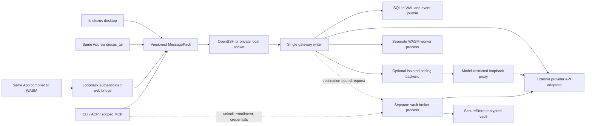

# Agent 206 architecture

Agent 206 replaces RustyClaw's large runtime with a small Rust workspace. The
security model is the compatibility target; legacy module boundaries are not.
This document distinguishes the current vertical slice from the target system.
See [status.md](status.md) for the implementation ledger.

## Boundaries



`a206-core` is renderer-independent state, commands and policy. `a206-protocol`
is bounded MessagePack framing. `a206-runtime` owns the state machine, journal,
provider adapter, SSH, ACP/MCP and host services. `a206-extensions` validates
manifests and runs WASM. `a206-mcp` validates, sandboxes and talks to
user-configured MCP servers (`docs/mcp.md`). `a206-vault` preserves the SecureStore format with a
narrow API. `a206-ui` contains one fc-dioxus component tree. `agent206` selects
the renderer or service entry point.

The UI never stores a provider credential. `a206-broker` is a separate process
that owns the decrypted vault; the gateway asks it to send credentialed provider
requests to user-bound origins and never receives the value. The CLI is the first
trusted broker surface; desktop/TUI enrollment and agent approvals are pending, so
this is not yet a replacement for RustyClaw's complete secret approval system.

## Single writer and process ownership

One local gateway owns a state directory, protected by an advisory file lock.
A mode-0600 Unix socket in a mode-0700 directory connects desktop, CLI and protocol
adapters to that process. The first client starts it. Subsequent clients attach.
The GUI, CLI, ACP and MCP do not open independent mutable state snapshots.

A remote connection runs `agent206 gateway --stdio` using ordinary OpenSSH;
that entry point bridges to the same remote per-user socket. Strict host key
checking is mandatory. SSH's configured identities and agents are respected;
unknown hosts require explicit SSH pairing outside the application today.
Keepalives detect dead peers. TCP/SSH retransmits lost packets; the application
handles fragmented frames and records durable request IDs and event cursors.

The service persists beyond the window that started it. The shared Gateway page
controls start/stop/restart/reconnect on desktop, web and terminal; CLI lifecycle
commands use the same controller.
Windows named pipes remain follow-up work.

WASM builtins execute in a separate `extension-worker` child with a cleared
environment, no WASI/host imports, bounded fuel/memory/output, and a five-second
parent timeout. This is an interpreter sandbox plus process separation, not yet
an OS sandbox for third-party installation. Only the bundled capability-free
extension can be launched in this build.

Joshua is started as an owned child process or an SSH session with a loopback
forward. We never search for or kill unrelated processes. Stopping a remote SSH
session does not establish a verified remote-process shutdown; remote supervision
and signed installers need additional work. The process running is not equivalent
to model readiness: readiness is established by a successful catalog API fetch.
Managed provider identity is persisted separately from user connections. Stop,
observed process exit and gateway restart retire that identity, its catalog and
associated model selections/grants; retiring an active provider also cancels its runs.
An owned connection can be relabeled while running. Stop Joshua before removing
it or changing its endpoint, protocol or credential reference; settings updates
cannot silently repoint an identity that will later be retired by the manager.

## Permission model

For delegated work:

```
effective = user grants ∩ mode ceiling ∩ thread policy ∩ parent grants
            ∩ requested task grants ∩ extension manifest
```

Capabilities and permitted model/provider pairs are separate sets. Empty means
none. Agents cannot write either set. Each thread has an explicit subagent model
allowlist; adding a model to an API catalog never adds it to that allowlist.
Subagents get a project association and parent identity; no parent's raw secrets.

The current MCP surface is read-only self-introspection by default. A user can
explicitly authorize editing only the bound conversation’s title when launching
MCP with `--allow-title-edit`. Other sessions do not advertise or accept that tool.
It has no
installation, secret, approval, arbitrary shell or global configuration tool.
Future tools must get an authenticated actor binding from the gateway and perform
policy checks at execution, not trust a client-supplied role or hidden button.

## Data contracts

- TOML: user settings, mode prompts, theme choices, plugin manifests and docs examples.
- MessagePack: application-owned requests, replies, snapshots, events and extension ABI.
- JSON: external provider protocol, ACP, MCP and legacy SecureStore file compatibility.
- SQLite: transactions, durable event ordering and accepted command receipts.

A command ID identifies both request bytes and its response. Reusing it with a
different body is an error. A duplicate accepted-but-unfinished command returns
an indeterminate outcome instead of repeating a side effect. This is not an
exactly-once guarantee for an external API. Recovery requires inspecting state.
Events retain a bounded replay window; old or future cursors require a new snapshot.
Clients reconnect for unsent requests after an unexpected disconnect; they do not
repeat an accepted command. Explicit shutdown persists a private stop marker;
only user Start/Restart can resume it. Reconnect and ordinary polling attach
without starting a service. Offline local stop persists under the same profile
lock as startup. Replaying a shutdown receipt does not stop a later process.
The shared lifecycle controller serializes user operations, uses bounded receipts
for duplicate control requests and verifies process-reported status. The web bridge
exposes this through an authenticated,
exact-origin MessagePack user endpoint; raw Shutdown remains denied there and
lifecycle controls are absent from agent MCP.

Stop closes admission, cancels accepted work, waits for bounded cleanup and stops
owned local inference before acknowledging. Failed cleanup restores work admission
and does not claim a successful shutdown; work already cancelled stays cancelled.
Concurrent cleanup attempts are serialized. Once cleanup and stop intent commit,
later shutdown requests acknowledge the committed stop without repeating cleanup.
The daemon drains accepted replies before exit; a local controller can reconcile
a lost stop reply only after verifying persisted stop intent and released profile
ownership. Losing an acknowledgement still completes shutdown. Start reuses a
running client connection so pending replies survive. The current UI polls snapshots; event
subscription and paged history remain follow-up work.

Catalogs carry source URL, retrieval time and expiry. A background refresh fetches
expired catalogs, with a five-minute delay after failed attempts. Missing limits,
prices, balances and capabilities remain unknown. There are no model/provider
catalog fixtures. Test APIs generate their identifiers and limits at runtime.

## Errors and diagnostics

Errors stay typed inside a process: each runtime module returns its own
`thiserror` enum (`GatewayError`, `StoreError`, `ProviderError`,
`BackendError`, `ClientError` and so on) whose variants keep the cause in
`source()` and add context instead of formatting the cause into a new string;
`anyhow` appears only at the binary's top level. Where a failure is handled (a command
reply, a failed run or download, a lifecycle report) the runtime captures it
once as an `a206_core::ErrorReport`: a client-actionable `ErrorKind`, the
outermost message, the bounded cause chain and a correlation id (the request,
run or transfer it belongs to). Kinds come from the error's types: each
runtime enum implements `error::Classified` (validation is `InvalidRequest`,
stale state `Conflict`, missing resources `NotFound` and so on), and core
types, I/O, protocol, storage, HTTP and timeouts are classified directly. Kinds
are never parsed from text; unclassified failures are `Other`.
URLs in transport errors are redacted before a report leaves the runtime.

The same capture is recorded through `tracing` as a structured event
(`operation`, `kind`, `correlation` and the report as an error value whose
`source()` walks the chain), so log subscribers see the chain rather than a flattened string.
`AGENT206_LOG` takes `tracing` filter directives (default `warn`); the daemon
logs to `gateway.log`, the terminal client to `tui.log` and other commands to
stderr.

`Reply::Error`, `GatewayReport.failure`, `Download.failure` and `Thread.error`
carry reports. A report encodes as `{kind, message, source, correlation}` and is
wire-compatible with the earlier `Error { message }` reply: older clients read the
message and ignore the rest. Gateway reports and downloads also keep their earlier
`error` text field, filled with the rendered chain, because older clients display
it; new code reads `failure_report()`, which falls back to that text (kind
`Other`) only for payloads written by an older gateway.

Only display code turns a report into text: UI rendering, CLI output, chat
transcript entries and model-facing tool results. Everywhere else the report
travels as a value. Clients keep the report, record it, and render it with `ErrorNotice`
(kind, message, collapsible causes and the correlation id to find in logs). The CLI returns it as its error, so the
exit message shows the whole chain.

A deliberately discarded `Result` is written `.ignore()` (`a206_core::Ignore`)
with a comment saying why its failure is unactionable;
`clippy::let_underscore_must_use` denies `let _ =`. Anything with a failure
someone could act on is propagated or recorded instead.

## Provider presets and optional coding backends

The shared Connections page and CLI ship a broad provider library spanning hosted
and local services, including DeepSeek, Moonshot, Alibaba Cloud, Z.ai,
MiniMax, SiliconFlow, StepFun, Hunyuan, Volcengine and Qianfan. Names, protocols, endpoint
defaults and setup instructions ship with the app; no accounts are activated and
no models selected implicitly. TOML `provider_presets` stores user additions and
overrides, hidden IDs and the bundled-list opt-in. The GUI edits the same library;
existing accounts do not change when a preset is edited, hidden or removed.
API-discovered model facts retain source, retrieval
and expiry metadata. Native Anthropic and Gemini adapters follow bounded pagination
and implement text generation; OpenAI-compatible APIs retain their existing path.
Unknown prices and balances remain unknown. Anthropic generation uses an 8,192-token application request budget capped by a
reported output limit when available, not a static
model limit. Gemini reasoning-level mapping is not offered without supported API
metadata and an implemented protocol mapping.

A model provider supplies inference to Agent 206's own orchestration. A coding
backend supplies an external agent loop. Keep these independently selectable:
Anthropic as a provider is distinct from Claude Agent as a coding backend.
Configured Codex runtimes use the documented app-server interface; configured
Claude Agent runtimes use the existing Claude Agent SDK ACP adapter and official
Rust ACP client SDK. Agent 206's own ACP agent entry point remains available.
Backend selection and workspace read/edit/command grants are per root thread,
checked against mode ceilings. External delegation is explicitly disabled until
we can enforce separate policy for every child. Native backend tools that fit the
explicit grants may run inside the OS boundary; expansion requests are denied.
No client filesystem, terminal or authentication capabilities are advertised over
ACP, and arbitrary MCP server installation is unavailable.

Each external turn starts a new supervised child with a bounded transcript and
user-editable mode prompt. It uses a private temporary home, cleared environment,
and scratch working directory, preventing discovery of user/project agent settings,
hooks and plugins. Granted project paths are explicit task context. Runtime code
must live in a separate, user-selected installation directory; no project/state/home
ancestor can serve as that installation root. Native executables, required libraries
and the Claude adapter must be inside it. See [coding-backends.md](coding-backends.md).

The current macOS supervisor uses deny-by-default Seatbelt filesystem and network
rules. Other platforms fail closed until equivalent isolation exists. The backend
can connect only to the supervisor's ephemeral loopback proxy port. The proxy accepts
an opaque, per-run capability and only the selected API-discovered model; it strips
that capability before forwarding, rejects other paths/models, bounds response
streams and request counts, and caps inference output budgets. It does not read
vault secrets and is not a replacement for the missing encrypted credential broker.
Authenticated providers remain disabled. Backend configuration/provider changes
cancel affected active runs; parent model revocation also cancels delegated runs.
Cancellation closes the proxy, kills the process group and reaps its root before
recording the run as cancelled. Text and bounded operation summaries update the
conversation; final authoritative Codex items replace provisional text.

The Claude adapter is Apache-2.0, but the Claude runtime has separate Anthropic
terms. Use API-key authentication once the broker is connected unless Anthropic
approves another arrangement; subscription login is not offered. Runtimes are not
bundled or installed by this build. See [upstream.md](upstream.md) for primary sources.
Vendor-runtime acceptance, authenticated integration, session resume, interactive
approvals and external subagent policy remain further work.

## UI direction

Typed Dioxus Router routes render through a persistent shell layout and an Outlet.
fc-dioxus router-aware links retain native link behavior and current-page semantics;
buttons invoke commands. Conversation UUIDs and the optional split UUID live in the
route, with no parallel page/selection state. The web renderer uses browser history;
desktop uses its renderer history, with explicit in-memory history for renderers
that do not supply one. App Back/Forward controls use the same navigator.

Direct conversation links wait for the first gateway snapshot before declaring a
thread missing. Unknown pages and unavailable threads offer recovery; no unrelated
thread is substituted. New threads navigate after the snapshot refresh. The web
bridge serves the SPA entry point for HTML page requests so deep links can reload,
while reserved API/bootstrap/asset paths and non-HTML requests keep their errors.
Consuming an authorization fragment preserves the route, query and history state.
URLs are local to the current gateway profile and never confer authority. Drafts
and unsaved forms are not yet preserved when their route unmounts.

The workbench separates navigation, conversations and inspection into accessible
resizable panes. The desktop is the primary entry point. Concurrent conversations
can share a split view. Projects have a coordinator; threads own mode/model policy.

The shared tree uses fc-dioxus cards, buttons, fields, selects, composer, chat,
messages, status, metrics, progress, transfers, splitters, alerts, browser chrome
and ThemePicker. Product CSS controls composition using future-css tokens; the
component library owns component appearance and interaction. The new vector mark
is in `crates/ui/assets/agent206.svg`.

The toolkit pin builds on stable Rust. The environment's default nightly rejects
an upstream raw-identifier format capture; the stable toolchain avoids needing a
local dependency patch. A maintained Dioxus 0.7 TUI fork is pinned by full commit.
The terminal shares the component tree; browser-dependent behaviors need manual
terminal validation and fallback work.

## Next implementation gates

1. Complete the vault broker with authenticated encrypted IPC, destination-bound
   operations, TOTP and RustyClaw policy migration; adversarial tests before enabling.
2. Agent run scheduler, streaming/tool-call loop, task budgets, hierarchical
   cancellation, approvals, context compaction and per-task model selection.
3. Versioned extension SDK with bounded MessagePack inputs, host calls and typed UI
   contributions. Agent-built packages require a user-reviewed manifest and digest.
4. Signed release discovery and verified local/SSH installers for Agent 206 and
   Joshua, with rollback, platform checks and explicit service ownership.
5. Forge-neutral PR/CI adapters, document plugins, browser broker, and accounting
   integrations using only APIs that actually expose the needed facts.

## Local web authority

The web bridge binds only to 127.0.0.1. A one-use bootstrap URL establishes a
bearer session in origin-scoped browser localStorage, shared by tabs of that exact
origin and invalidated when the bridge process restarts (a rejected bearer is
discarded); the fragment is removed from the address bar immediately. Requests
for `localhost:<port>` redirect to the canonical `127.0.0.1` origin before any
handler runs, so the one-use link is never claimed from an origin that cannot
hold the bearer. Application-owned requests carry the bearer in
an explicit Authorization header and require the exact Host, Origin and binary
content type. The application issues no session cookie: cookies ignore ports and
could otherwise be sent to a local development server inside the preview browser.
App chrome cannot be framed. This is a single-user loopback bridge, not a public
hosting/authentication system.

Public downloads validate all resolved addresses, pin them for the TLS request,
follow only validated HTTPS redirects, and bypass ambient proxy settings. Transfer
events retain the source origin rather than signed query strings. File reads use
cap-std directory capabilities, so a symlink cannot turn a relative project read
into ambient filesystem access. Subprocess output is bounded while being read.

Settings writes use a revision check to reject stale updates. Per-model delegation
changes are atomic commands, and removing a parent's model permission prevents a
new request by its child. These are runtime checks, separate from prompt wording.

## Composer metadata and attachments

The shared composer uses fc-dioxus Card, Textarea, Select, IconButton, Badge and
Popover. Its toolbar stays inside the text surface, with two compact rows when a
conversation column is narrow. It shows unknown values explicitly. Context use is
the last request's provider-reported input usage, not a fabricated live token count.

The current compatible catalog adapter accepts optional API fields
`context_length`, `pricing.prompt`, `pricing.completion`,
`supported_reasoning_efforts` on model records, and `balance`, `balance_currency`,
`token_balance` on the catalog response. These metadata fields are not universally
provided by the OpenAI-compatible models standard. Unreported effort choices remain
unavailable; no model-name heuristics or hardcoded effort lists are used. Gateway
validation checks the selected effort against the current catalog on save and send,
and model changes reset it. Standard provider-specific accounting adapters remain
a separate integration gate.

User-selected attachments currently support UTF-8 text only. The client bounds
reads, stages removable filename/size chips and sends nothing until submission. The
gateway enforces eight files and 128 KiB combined message/document content, stores
attachments with the user message and includes their named text in provider input.
No local file paths or automatic workspace reads are sent. Image, PDF and audio
attachments require format/capability adapters and are not implemented by this
text attachment interface.
